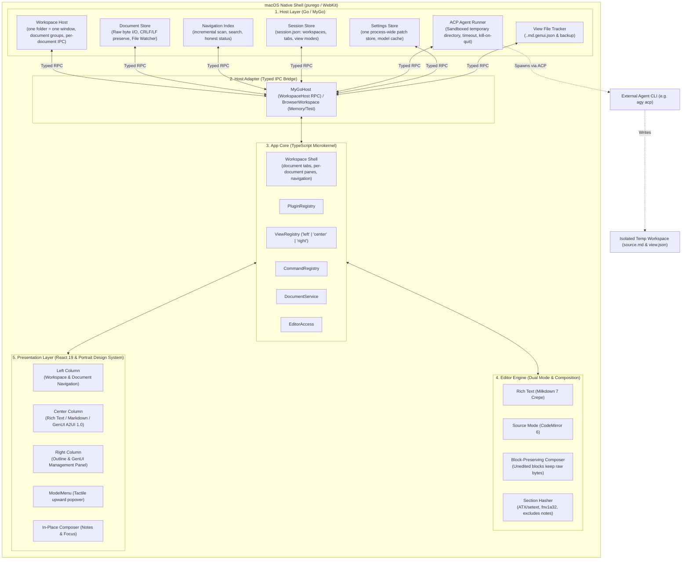
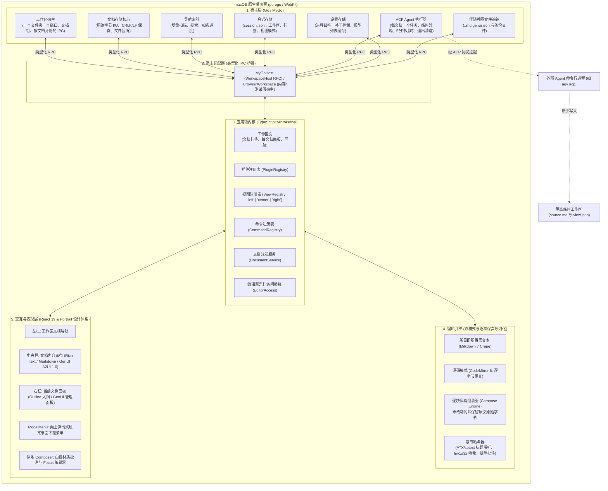

# Architecture / 系统架构

[English](#english) | [中文](#chinese)

---

## English

Mark Go Go is a local-first, native macOS Markdown editor and AI reader prototype designed with a block-preserving architecture and an agent-driven generative reading surface (GenUI).

### 1. High-Level Architecture Diagram

---

### 2. Core Architectural Layers

#### 1. Host Layer (Go / MyGo)
- **Workspace Ownership**: One folder is one window. `WorkspaceHost` (`documenthost.go`, `workspace.go`) hosts the window's document group: ordered tabs, one active document, per-window `workspaceChanged` / `navChanged` events, and document-scoped calls that always name a `documentId`. A document keeps its identity across path, tab, window, first save and Save As; the same disk file has exactly one editing session app-wide; routing picks the deepest containing workspace or creates one at the file's parent.
- **Persistence Authority**: Native Go backend using `purego` bindings to macOS WebKit. Owns filesystem access, raw-byte reading and writing, CRLF/LF line ending preservation, atomic saves, and `fsnotify` file change detection.
- **Navigation Index**: `index.go` / `navmeta.go` scan the workspace root incrementally, publish honest `scanning` / `indexing` / `ready` progress with `indexed` / `total`, index unsaved text of open documents, and answer `SetFilter` with heading hits.
- **Session Store**: `session.go` / `restore_host.go` persist `session.json` (workspaces, tab order, active document, view modes) after every window acknowledges the quit flush, then restore it after MyGo's recovery copies and launch files, never replaying generation. A flush delivers what the pane really holds — the text on screen (`editor.getMarkdown()`), else the host-loaded core document state — so an untouched, reloaded or remounted document is never written empty; a disk-opened document gets a new MyGo id at restore, so the stored active tab is mapped to the id its document really has now.
- **ACP Agent Runner**: Executes external AI agents (such as `agy acp`) using the Agent Client Protocol (ACP). One slot per document, captured settings/text/path at start; runs in an isolated temporary directory containing only a read-only copy of the document, enforcing strict timeouts (5 minutes), atomic view updates, and automatic process tree termination on quit.
- **Settings & Model Caching**: One process-wide `settings.json` store. `SetSettings` writes only the fields of the intent patch, returns the committed value, and broadcasts `settingsChanged` to every window; model lists are cached from the ACP `session/new` `configOptions` handshake and are never writable by a patch.
- **Companion View Tracking**: Monitors hidden companion view files (`.<name>.md.genui.json`) and backup files (`.<name>.md.genui.prev.json`). The first snapshot is emitted before the directory watch starts, a catch-up snapshot follows, and the watch follows the document when its path moves.

#### 2. Host Adapter Layer (TypeScript)
- Exposes typed TypeScript bindings generated via MyGo (`web/src/host/generated/mygo.ts`), bound as `WorkspaceHost`.
- `WorkspaceAdapter` owns navigation, documents and the per-document `HostAdapter`; an adapter is bound to one `documentId` for its lifetime and never retargets through the active tab.
- Two interchangeable implementations:
  - `MyGoHost`: Connects to the real macOS Go backend over WebKit IPC and routes native File/Edit commands to the captured document.
  - `BrowserWorkspace` / `BrowserHost`: In-memory adapters (one shared settings store per workspace) used for headless Vitest testing and standalone web previews.

#### 3. Application Core Microkernel (TypeScript)
- A decoupled, event-driven microkernel comprising:
  - `Workspace Shell` (`App.tsx`): renders the tab strip, one `DocumentPane` per open document, the left navigation pane, and Welcome/recents; keeps hidden panes mounted so switching tabs preserves editor state.
  - `PluginRegistry`: Manages plugin lifecycle, activation, rollback, and cleanup.
  - `ViewRegistry`: Manages view registrations across three designated locations (`'left'`, `'center'`, `'right'`), along with reactive status dots.
  - `CommandRegistry`: Centralized keyboard shortcuts and command execution.
  - `DocumentService`: Broadcasts snapshots and document change notifications.
  - `EditorAccess`: Decoupled interface to the active editor's selection, cursor offset, and focus.

#### 4. Editor Engine Layer (TypeScript)
- **Dual-Engine Architecture**:
  - **Rich Text (WYSIWYG)**: Milkdown 7.23 with custom `CrepeBuilder`.
  - **Source Mode**: CodeMirror 6 for byte-exact plain text Markdown editing with instant toggle (`⌘/`).
- **Block-Preserving Composition**: Unlike standard Markdown serializers that reformat the entire document on save, Mark Go Go parses documents into discrete ProseMirror block nodes. Unedited blocks retain their exact original source bytes.
- **Special Blocks (ADR 0006)**: Frontmatter, GitHub alerts, footnote definitions, meta code fences and math render as designed blocks while staying atomically byte-preserving; raw HTML and unsupported syntax remain visible as `Kept as written`. `Edit` opens an in-place Markdown composer for that block only, and saving rewrites just that block's source with its original line endings.
- **Native Edit Target**: `nativeEdit.ts` registers each document's editor (ProseMirror or CodeMirror) as the target of Edit > Undo/Redo, so the native menu acts on the captured document's real history instead of WebKit's empty undo manager.
- **Section Hashing**: Computes normalized `fnv1a32` hashes of section bodies across ATX/setext headings to detect whether a section changed in source, while deliberately excluding note comments.

#### 5. Presentation Layer (React 19 & Portrait Design System)
- **Workspace Chrome**: A document tab strip above the workspace body (same-name tabs are disambiguated by parent folder; unsaved, generating, conflict, deleted and read-only badges), and the left pane's file tree, filter, splitter, breadcrumbs and Welcome/recents.
- **Portrait Three-Column Layout**:
  - **Left Column**: Workspace file navigation.
  - **Center Column**: Dedicated strictly to document content for the active tab (Rich text, Markdown, or GenUI A2UI reading cards). Free of generation toolbars or settings forms.
  - **Right Column**: Document-scoped panels with a top segmented switcher:
    - `Outline`: Real-time heading tree with bi-directional cursor synchronization.
    - `GenUI Management Panel`: Generation state, primary action, out-of-date component list, Focus request editor, and pinned footer (read-only Agent, Model menu, generated time, Undo).
  - **Narrow-Window Responsive Behavior**: Windows `< 1180px` automatically collapse the right column into an overlay sheet (`.r-float`).
- **A2UI 1.0 GenUI Viewer**: Renders AI-structured reading views combining 5 layout primitives (`Column`, `Row`, `Tabs`, `Card`, `Text`) and 5 custom high-density components (`KeyPoints`, `MetricGrid`, `ComparisonTable`, `Timeline`, `Checklist`). KeyPoints folding, ComparisonTable sorting (keyboard-operable headers with `aria-sort`), table scroll and tab selection are per-document reading state that never writes the document.
- **Light-only Portrait with Offline Assets**: Semantic surfaces, ink tiers, tactile shadows, status colours and separate content-semantic colours are fixed light tokens; `color-scheme` is light with no appearance switch. Fonts and icons ship as bundled `.woff2` and load without network access.
- **ModelMenu**: Upward tactile popover menu styled with paper surface, 10px radius, pop shadow, and checkmark indicators; selecting a model writes only the model field.
- **In-Place Paper Composer**: Replaces modal `<dialog>` popups with inline auto-growing paper sheets (`.composer`) for Notes, Focus, special-block Markdown and Locate-agent editing (`⌘↩` to save, `Esc` to cancel).

---

### 3. Core Architectural Principles

1. **The Markdown File is the Single Source of Truth**:
   - The `.md` file on disk is the authoritative document. GenUI views are strictly read-only derived representations. Deleting a view file never damages the document.
2. **Zero Unintentional Formatting Drifts**:
   - Saving a file only writes modified blocks. Trailing spaces, customized line breaks, and untouched syntax styles are never rewritten.
3. **One Editing Session per File, Document-Scoped Work**:
   - A `documentId` owns its content, view watch and generation slot for its whole life. Native commands, flushes, saves, view follows and generations name that identity; nothing retargets through whichever tab is active.
4. **Strict Sandboxing for Agent Runs**:
   - AI agents never run directly inside the user's workspace directory. All generation takes place in isolated temporary workspaces with read-only copies of the source document.
5. **Content and Management Separation**:
   - Reading surfaces and generation controls never share visual space. Content remains in the center column; management controls live in the right column.
6. **One Settings Store, One Commit Order**:
   - Generation settings belong to the process, not a document. Patches write only their own fields, a committed write returns the new value and is announced to every window, and a running job keeps the value it captured.

---

## 中文

Mark Go Go 是一款面向 macOS 的本地优先（Local-First）Markdown 原生编辑器与 AI 派生阅读器原型，采用逐块保真（Block-Preserving）保存架构以及由外部 AI Agent 驱动的组件化阅读界面（GenUI）。

### 1. 系统总体架构图

---

### 2. 五层架构设计

#### 1. 宿主层（Go / MyGo）
- **工作区归属**：一个文件夹对应一个窗口。`WorkspaceHost`（`documenthost.go`、`workspace.go`）承载该窗口的文档组：有序标签、一个活动文档、按窗口推送的 `workspaceChanged` / `navChanged`，以及所有带 `documentId` 的文档级调用。文档身份跨路径、标签、窗口、首次保存与另存为不变；同一磁盘文件全应用只有一个编辑会话；路由取包含该文件的根目录最深的工作区，否则在父目录新建。
- **持久化权威**：基于 `purego` 无 CGO 绑定的 macOS 原生 Go 宿主，拥有磁盘文件的最高读写权威，保证文件按字节原样读写、保留原始换行符（CRLF / LF），提供原子保存、窗口焦点与 `fsnotify` 外部文件变更监听。
- **导航索引**：`index.go` / `navmeta.go` 增量扫描工作区根目录，如实发布 `scanning` / `indexing` / `ready` 与 `indexed` / `total`；已打开文档的未保存文本也进入索引；`SetFilter` 返回标题与章节命中。
- **会话存储**：`session.go` / `restore_host.go` 在每个窗口确认退出 flush 后写入 `session.json`（工作区、标签顺序、活动文档、视图模式），并在 MyGo 打开恢复副本与启动文件之后恢复，从不重放生成任务。flush 交付面板真正持有的文本（屏幕上的 `editor.getMarkdown()`，否则宿主载入的核心文档状态），未编辑、被重载或重新挂载的文档不会被写成空；从磁盘打开的文档在恢复时得到新的 MyGo id，因此存储的 active tab 映射到该文档现在真实的 id。
- **ACP Agent 执行器**：遵循 Agent Client Protocol (ACP) 标准拉起用户本机的外部 AI Agent（如 `agy acp`）。每份文档一个任务槽，开始时捕获设置、文本与路径；任务约束在仅包含原文只读副本的临时沙箱目录内，设置 5 分钟硬超时、进程树退出清理及原子重命名提交。
- **设置与模型缓存**：进程级唯一的 `settings.json`。`SetSettings` 只写意图补丁里出现的字段，返回提交后的值，并向每个窗口广播 `settingsChanged`；模型列表来自 `session/new` 握手的 `configOptions` 缓存，补丁永远不能写入它。
- **伴随视图追踪**：监听原文同级隐藏文件 `.<name>.md.genui.json` 及其备份文件 `.<name>.md.genui.prev.json`。第一份快照在目录监听建立前送出，随后再送一份追赶快照；文档路径移动时跟随新路径。

#### 2. 宿主适配层（TypeScript）
- 提供类型安全的 Go ↔ TS 桥接接口（[`web/src/host/types.ts`](file:///Users/dmus/Documents/Mark%20Go%20Go/web/src/host/types.ts) 与自动生成的 [`web/src/host/generated/mygo.ts`](file:///Users/dmus/Documents/Mark%20Go%20Go/web/src/host/generated/mygo.ts)），绑定名为 `WorkspaceHost`。
- `WorkspaceAdapter` 负责导航、文档与每文档的 `HostAdapter`；适配器在生命周期内绑定一个 `documentId`，不从活动标签重定向。
- 双实现无缝切换：
  - `MyGoHost`：在桌面环境中通过 WebKit 消息通道与 Go 交互，并把原生 File/Edit 命令分派给点击时捕获的文档。
  - `BrowserWorkspace` / `BrowserHost`：全内存运行环境（每个工作区共享一个设置存储），用于 Vitest 自动化单元测试与网页端独立预览。

#### 3. 微内核核心层（TypeScript）
- 职责明确的低耦合微内核：
  - `工作区壳`（`App.tsx`）：渲染标签栏、每份文档一个 `DocumentPane`、左栏导航与 Welcome/最近工作区；非活动面板保持挂载，切换标签不丢编辑器状态。
  - `PluginRegistry`：管理插件依赖、激活生命周期、异常回滚与卸载清理。
  - `ViewRegistry`：支持 `'left'`、`'center'`、`'right'` 三栏视图注册及标签状态圆点（`ViewStatusDot`）分发。
  - `CommandRegistry`：统一注册全局键盘快捷键与菜单命令。
  - `DocumentService`：广播当前文档快照与变更通知。
  - `EditorAccess`：解耦提供活动编辑器的当前光标偏移、选区与跳转定位接口。

#### 4. 编辑引擎与保真层（TypeScript）
- **双模式编辑器**：
  - **Rich text 所见即所得**：基于 Milkdown 7.23 与定制的 `CrepeBuilder`，提供现代无衬线编辑体验。
  - **源码模式**：基于 CodeMirror 6，支持精确光标偏移定位与 `⌘/` 瞬间无损切换。
- **逐块保真组装（Block-Preserving Composition）**：
  - 将 Markdown 解析为 ProseMirror 顶层块节点。保存时只重新序列化用户真实改动过的块，未改动的块直接拼接原字节，从根本上杜绝传统 Markdown 编辑器保存时格式全面跑飞（全篇缩进重排、列表符号变异、空行丢失）的通病。
- **特殊块（ADR 0006）**：YAML frontmatter、GitHub alert、脚注定义、带 meta 的代码块与数学块按设计呈现，但仍是原子保真的顶层节点；原始 HTML 与不支持的语法继续以 `Kept as written` 显示且不执行。点击 `Edit` 只在该块原地展开 Markdown 编辑区，保存只改写该块的原文（保留它自己的行尾）。
- **原生 Edit 目标**：`nativeEdit.ts` 把每份文档的编辑器（ProseMirror 或 CodeMirror）注册为 Edit > Undo/Redo 的目标，原生菜单作用于该文档的真实历史，而不是 WebKit 空撤销栈。
- **章节哈希与哈希防抖**：提取 ATX / setext 标题章节，计算 `fnv1a32` 正文哈希以精准判定“原文已改（`Source changed`）”，计算时自动剔除批注注释块。

#### 5. 交互与表现层（React 19 & Portrait 设计系统）
- **工作区外框**：工作区主体上方的文档标签栏（同名标签用父目录区分；带未保存、生成中、冲突、已删除、只读徽标），以及左栏的文件树、筛选、分栏、面包屑与 Welcome/最近工作区。
- **Portrait 极简三栏工作区**：
  - **左栏**：工作区文件导航与筛选。
  - **中央栏**：当前标签纯粹的内容画布（Rich text / Markdown / GenUI 视图），顶部仅保留 44px 路径栏与凹陷分段三模式切换器，彻底剔除生成表单与干扰元素。
  - **右栏**：当前文档的专属面板，顶部凹陷分段切换 `Outline`（默认首位）与 `GenUI`（带状态圆点）。
  - **窄窗自适应**：窗口宽度 `< 1180px` 时右栏自动收起，手动点开时以浮层（`.r-float`）形式贴在右侧，点击中央正文自动收起。
- **A2UI 1.0 GenUI 阅读视图**：支持 5 种基础布局组件与 5 种高级卡片组件（`KeyPoints` 要点、`MetricGrid` 指标网格、`ComparisonTable` 对比表、`Timeline` 时间线、`Checklist` 只读清单），每个组件底座配备来源引用条（`From` 标题、`Source changed` 标记、`Edit in source` 一键定位修改、`Note` 原地加批注）。KeyPoints 折叠、ComparisonTable 排序（列头为可键盘操作的按钮并带 `aria-sort`）、表格滚动与标签页选择都是每文档的阅读状态，从不写文档。
- **仅浅色的 Portrait 与离线资源**：表面、墨色、触觉阴影、应用状态色与原文内容语义色都是固定的浅色 Token；`color-scheme` 为 light，没有外观切换。字体与图标是随包 `.woff2`，不请求网络。
- **ModelMenu 弹出菜单**：26px 触觉微凸起按钮，在按钮正上方弹出 10px 圆角白纸菜单（`.mmenu.pop`），支持外部点击与 `Escape` 关闭，生成时禁用；选择模型只写模型字段。
- **原地白纸 Composer**：正文批注、卡片批注、右栏生成要求（Focus）与特殊块 Markdown 都在目标落位处原地展开为白纸卡片（`.composer`），输入高度自适应，支持 `⌘↩` 提交与 `Esc` 取消，坚决不使用任何居中模态 `<dialog>` 弹窗。

---

### 3. 核心设计原则

1. **Markdown 原文是唯一权威**：
   - 磁盘上的 `.md` 文件是所有数据的唯一真实来源；GenUI 视图仅为单向派生的只读产物。删除或重新生成视图绝不损伤正文任何内容。
2. **严苛的逐字节保真**：
   - 尊重作者的排版习惯。未修改的行末空格、代码缩进和标点符号在保存时绝不被格式化脚本篡改。
3. **同一文件一个编辑会话、一切按文档身份执行**：
   - `documentId` 在生命周期内拥有自己的内容、视图跟随与生成槽；原生命令、flush、保存、跟随与生成都指名这个身份，绝不按当前活动标签重定向。
4. **强隔离沙箱运行**：
   - 外部 Agent 只能在隔离临时目录中访问原文副本，无权遍历或直接读写宿主工程目录。
5. **阅读与控制严格分离**：
   - 阅读区中央只负责读写内容；生成触发、配置与生命周期管理统一归于右栏面板。
6. **唯一设置存储、唯一提交顺序**：
   - 生成设置属于进程而不是某份文档：补丁只写自己的字段，成功写入返回新值并广播到每个窗口，运行中的任务保留开始时捕获的值。
