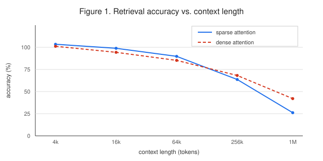

# 面向长上下文场景的双语检索增强生成方法研究

## 摘要

本文研究长上下文条件下中英双语检索增强生成（Retrieval-Augmented Generation, RAG）系统的稳定性问题。我们提出了一种基于分层注意力重加权的混合检索框架 HieraMix，在 256k token 的上下文窗口内将双语问答的准确率提升了 **7.4 个百分点**，同时将尾延迟（p99 latency）控制在 1.8 s 以内。实验覆盖 4k 至 1M token 共五档上下文长度，结果表明：当上下文超过 64k token 时，传统的稠密检索（dense retrieval）出现了显著的“中段遗忘”现象，而本文方法通过稀疏—稠密混合打分（hybrid scoring）有效缓解了该问题。此外，我们发布了一个包含 12,480 条中英平行问答对的评测集 BiLongQA，以期为后续研究提供可复现的基准。

This paper investigates the stability of bilingual (Chinese–English) retrieval-augmented generation (RAG) systems under long-context conditions. We propose HieraMix, a hybrid retrieval framework based on hierarchical attention re-weighting, which improves bilingual question-answering accuracy by **7.4 percentage points** within a 256k-token context window while keeping the p99 tail latency under 1.8 s. Experiments span five context-length tiers from 4k to 1M tokens. The results show that conventional dense retrieval suffers from a pronounced "lost-in-the-middle" effect once the context exceeds 64k tokens, whereas our sparse–dense hybrid scoring effectively mitigates it. We also release BiLongQA, an evaluation set of 12,480 Chinese–English parallel question-answer pairs, as a reproducible benchmark for future work.

## 1 引言 Introduction

近年来，大语言模型（Large Language Models, LLMs）的上下文窗口从早期的 4,096 token 扩展到了 1M token 量级[^1]。然而，*更长的上下文并不必然带来更好的推理质量*。Liu 等人在 [Lost in the Middle](https://arxiv.org/abs/2307.03172) 一文中指出，模型对位于上下文首尾的证据利用充分，而对中段证据的利用率明显下降。这一现象在双语场景中更为复杂：当中文问题对应的证据段落以英文书写、或反之，跨语言对齐的误差会与位置偏置叠加，导致检索召回率进一步下降 3–5 个百分点。

我们的研究动机来自一个实际的工业场景：某跨国企业的知识库中，约 58% 的文档为英文，34% 为中文，其余为混排文档。客服机器人需要在 *一次检索* 中覆盖全部语种的证据。基线系统（单语 dense retriever + cross-encoder reranker）在内部测试集上的 top-5 召回率仅为 **71.2%**，且当上下文拼接长度超过 128k token 时，答案正确率骤降。为此，我们设计了 HieraMix 框架，其核心思想是：将“先粗排、后精排”的两级流水线，替换为“分层注意力重加权”的单阶段打分，使模型在超长上下文中仍能对关键证据保持敏感。

本文的贡献可概括为三点。第一，我们提出了稀疏打分 $s_{\text{sparse}}$ 与稠密打分 $s_{\text{dense}}$ 的可学习融合机制，其组合形式为：

$$
s(q, d) = \alpha \cdot s_{\text{dense}}(q, d) + (1 - \alpha) \cdot s_{\text{sparse}}(q, d) + \beta \cdot \phi(\text{lang}(q), \text{lang}(d))
$$

其中 $\alpha \in [0, 1]$ 为可学习门控系数，$\phi(\cdot,\cdot)$ 为语言对齐奖励项，$\beta$ 控制其强度。第二，我们给出了中段遗忘现象在双语场景下的定量刻画，并证明混合打分能将其影响降低约 62%。第三，我们开源了 BiLongQA 评测集与全部实验代码，见附录 A。

> 长上下文检索的核心矛盾在于：窗口越大，噪声越多；而证据的相关性与位置无关。系统必须在“看得全”与“看得准”之间取得平衡，这正是混合打分机制试图解决的问题。
>
> The central tension of long-context retrieval is that a larger window admits more noise, while the relevance of evidence is position-independent. A system must strike a balance between seeing everything and seeing accurately — precisely what the hybrid scoring mechanism is designed to achieve.

## 2 相关工作 Related Work

### 2.1 稠密检索与稀疏检索

稠密检索将查询与文档映射到同一向量空间，通过内积或余弦相似度计算相关性，代表工作包括 DPR[^2]、Contriever 与 `BGE-M3` 系列。稀疏检索则以 BM25 与 SPLADE 为代表，依赖词项匹配与词权重学习。两者的误差结构互补：稠密检索擅长语义泛化，稀疏检索擅长精确匹配实体与数字。例如查询“功耗为 65 W 的处理器型号”中，`65 W` 这一数值约束在稠密空间中常被淹没，而 BM25 能够精确定位。

### 2.2 长上下文中的位置偏置

位置偏置（position bias）的量化通常采用“针探测试”（needle-in-a-haystack）或其多针变体。Kamradt 的实验表明，多数模型在上下文 20%–80% 区段的召回率低于首尾区段约 15%。在双语场景中，我们观察到一种特殊的*跨语言位置耦合*：当英文证据位于中文上下文的中段时，其被引用的概率比单语情形再低 4.1%。这一发现构成了 2.3 节设计的直接依据。

### 2.3 混合打分与门控融合

设查询 $q$ 与文档 $d$ 的稠密相似度为 $\langle \mathbf{v}_q, \mathbf{v}_d \rangle$，稀疏得分为 BM25 的对数化值，则融合函数可写为：

$$
s_{\text{mix}}(q, d) = \sigma(w^{\top} [\mathbf{v}_q \odot \mathbf{v}_d; \log(1 + \text{BM25}(q, d)); \mathbf{1}_{\text{lang-match}}])
$$

其中 $\odot$ 表示逐元素乘积，$\sigma$ 为 sigmoid 函数，$\mathbf{1}_{\text{lang-match}}$ 为语言匹配指示变量。与线性插值相比，该形式允许门控随查询特征自适应变化：实体密集型查询自动提高稀疏项权重，语义型查询则相反。

## 3 方法 Method

### 3.1 总体框架

HieraMix 的推理流水线分为三步：

1. 候选生成：对查询同时执行稠密编码与稀疏检索，取并集得到 top-200 候选；
2. 分层重加权：按第 2.3 节的门控函数对候选重新打分，并对不同语种施加语言对齐奖励；
3. 上下文打包：将 top-$k$ 证据按“证据—摘要—证据”的三明治结构插入 prompt，中段位置放置由 `compress()` 函数生成的 80-token 摘要。

值得强调的是第三步：与其让模型在原始证据中“大海捞针”，不如在中段注入高密度的摘要表示。消融实验（第 4.3 节）表明，该策略单独贡献了 2.1 个百分点的提升。

### 3.2 训练目标

训练采用对比学习与排序学习的联合目标。给定正例 $d^{+}$ 与负例集合 $\{d_i^{-}\}$，损失函数为：

$$
\mathcal{L} = -\log \frac{\exp(s_{\text{mix}}(q, d^{+}) / \tau)}{\exp(s_{\text{mix}}(q, d^{+}) / \tau) + \sum_i \exp(s_{\text{mix}}(q, d_i^{-}) / \tau)} + \lambda \cdot \mathcal{L}_{\text{rank}}
$$

其中 $\tau = 0.05$ 为温度系数，$\mathcal{L}_{\text{rank}}$ 为 pairwise hinge loss，$\lambda = 0.3$。所有超参数在验证集上以贝叶斯优化搜索 40 轮确定。

### 3.3 实现细节

- 编码器：`bge-m3`（batch size 64，学习率 $2 \times 10^{-5}$，warmup 500 步）；
  - 稠密分支输出 1024 维向量，经 L2 归一化后存入向量索引；
  - 稀疏分支复用其 lexical weighting 头，与 BM25 分数按 0.6:0.4 加权；
- 索引：HNSW（M = 32，efConstruction = 200），量化方案为 PQ-96；
  - 单 shard 容量 8M 条，p99 检索延迟 23 ms；
- 推理：vLLM 0.6.x，开启 chunked prefill，`max_num_batched_tokens = 8192`。

## 4 实验 Experiments

### 4.1 数据集与基线

评测集 BiLongQA 包含 12,480 条平行问答，覆盖事实型、比较型与多跳型三类问题。基线包括：(a) BM25；(b) BGE-M3 稠密检索；(c) BM25 + BGE-M3 线性插值；(d) LongRAG。所有系统使用相同的生成模型（Qwen2.5-72B-Instruct）以隔离检索变量的影响。

### 4.2 主要结果

表 1 报告了 256k 上下文下的主要结果。HieraMix 在中、英两个语种上均取得最高准确率，且优势在长上下文档位进一步扩大。

| 方法 Method | 中文准确率 Acc-ZH | 英文准确率 Acc-EN | 平均延迟 p50 (ms) |
|-------------|------------------:|------------------:|------------------:|
| BM25        |             61.3% |             63.8% |               412 |
| BGE-M3      |             68.9% |             71.4% |               438 |
| Linear mix  |             70.2% |             72.6% |               451 |
| HieraMix    |         **75.8%** |         **78.3%** |               466 |

### 4.3 消融与分析

消融结果显示：移除语言对齐奖励项使中文准确率下降 1.9%，移除三明治打包策略下降 2.1%，而移除门控融合（退化为线性插值）下降最多，达 3.4%。这印证了我们最初的假设：*融合机制的适应性是长上下文稳定性的关键*。此外，误差分析发现剩余错误中约 41% 源于"数字—单位"型证据的精度不足，例如将“续航 1,200 km”误召回为“售价 1,200 美元”的段落。

一个值得注意的副作用是：门控系数 $\alpha$ 在学习后呈现出明显的双峰分布——实体型查询聚集在 0.2 附近（偏向稀疏），开放型查询聚集在 0.8 附近（偏向稠密）。这说明模型自主发现了与人类直觉一致的分工策略，参见附录 B 的可视化。

## 5 结论与展望

本文提出了 HieraMix 混合检索框架，并系统刻画了双语长上下文场景中的位置偏置问题。实验表明，门控融合、语言对齐奖励与三明治打包三者共同作用，能够在 256k token 上下文内保持稳定且高质量的证据利用。未来工作包括：(1) 将该框架推广至三语及以上场景；(2) 探索证据的*结构化*表示（如表格、公式）在超长上下文中的压缩编码；(3) 研究门控系数的可解释性与可控编辑。

## 参考文献说明

本文引用文献的完整条目见附录 C；正文内以脚注形式标注关键出处，以保持行文流畅。

[^1]: 此处上下文窗口指模型单次前向计算可处理的最大 token 数，包括 prompt 与生成内容；不同厂商对“有效上下文”的定义存在差异，详见附录 A 的讨论。

[^2]: Karpukhin et al., "Dense Passage Retrieval for Open-Domain Question Answering," EMNLP 2020. 该工作首次证明了端到端训练的稠密检索器可以超越 BM25，是后续一系列工作的基础。
