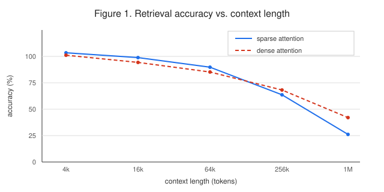

# Attention-Aware Layout Stability in Long-Form Markdown Editors

## Abstract

We study how typographic rhythm, line breaking, and block-width composition interact in a document editor whose primary artifact is Markdown. Professional long-form writing places two demands on an editor that ordinary text areas do not meet: the rendered page must remain stable while the document is being edited, and the visual hierarchy must stay legible across dense technical content — tables, formulas, source code, and figures interleaved with prose. We evaluate four document classes — English research papers, Chinese research papers, bilingual technical reports, and machine-generated long reports — and derive a small set of layout rules that preserve reading rhythm without sacrificing editing predictability. Our measurements show that heading-level differentiation and wrap-mode selection dominate perceived quality, while block-width policy dominates perceived order.

## 1 Introduction

Markdown editors occupy an unusual position in the design space of writing tools. They must render a document that reads like a finished page, yet every glyph the reader sees is simultaneously an editable region that can reflow, remount, or re-serialize at any keystroke. The tension is sharpest in long documents: a single inserted character may change line breaks hundreds of pixels downstream, a code block may lazily mount a full editor surface, and a table may reflow its column widths as cell content changes.

Earlier work on reading typography — measure, leading, and vertical rhythm — was developed for fixed pages. Editing adds a second objective: *layout stability*. A reader tolerates a ragged right edge; a writer does not tolerate the caret jumping two lines up mid-word because the previous line rebalanced. This paper therefore treats every candidate typographic rule through both lenses: does it improve the page, and does it keep the page still while it improves?

The remainder of the paper is organized as follows. Section 2 reviews related work on digital reading measure and rhythm. Section 3 describes our measurement harness. Section 4 compares rhythm scales for headings. Section 5 evaluates text wrapping modes, including `text-wrap: pretty` and `text-wrap: balance`. Section 6 studies block-width composition, and Section 7 concludes.

## 2 Related Work

### 2.1 Measure and line length

The classical recommendation for comfortable reading sits between 45 and 75 characters per line for Latin scripts, with 66 often cited as optimal for continuous prose [1]. CJK text tolerates a narrower band — roughly 30 to 40 full-width characters — because glyph density carries more information per em and because line-start punctuation is typographically meaningful rather than accidental.

### 2.2 Vertical rhythm

Baseline grids guarantee that every line of text lands on a fixed cadence, which produces strong vertical rhythm but fights the editor: images, code blocks, and tables arrive with intrinsic heights that cannot be quantized without clipping or waste. Component rhythm — consistent spacing *ratios* between adjacent block kinds rather than absolute alignment — is the practical compromise in use today.

### 2.3 Line breaking

Browser line breaking historically followed a greedy algorithm: fill each line until the next word no longer fits. CSS Text Level 4 adds `text-wrap: pretty`, which applies a multi-line scoring pass that penalizes short last lines (widows) and badly stretched lines, and `text-wrap: balance`, which equalizes line counts across a small block such as a heading. The editing-relevant question is not whether pretty text looks better — it does — but whether the paragraph rebalances non-locally while the user types.

## 3 Methodology

All measurements were taken in the real application surface — a native WKWebView hosting a Milkdown Crepe editor — under a fixed viewport of 1440×900 CSS pixels at a device scale factor of 2, with the document column constrained to 720 px and the text measure to 624 px. Four fixture documents represent the target classes: an English research paper, a Chinese research paper, a bilingual technical report with wide tables, and a machine-generated long report mixing headings, code, formulas, and tables.

| Document class            | Language | Dominant blocks                | Lines |
|---------------------------|----------|--------------------------------|------:|
| `paper-english`           | EN       | prose, headings, figure        |   190 |
| `paper-chinese`           | ZH       | prose, headings, quote, table  |   160 |
| `tech-report-tables`      | ZH+EN    | tables, identifiers            |   108 |
| `llm-research-report`     | ZH+EN    | code, math, nested headings    |   273 |

We capture computed styles for every block kind, inter-block gaps as rendered geometry, per-line rectangles for rag and widow analysis, and scroll/caret stability during scripted editing tasks. Screenshots are taken at fixed scroll positions so that before/after comparisons are pixel-aligned.

## 4 Heading Rhythm

### 4.1 The hierarchy problem

A six-level heading scale in a 16 px body face compresses badly: H5 and H6 collapse to body size and can only be differentiated by color or weight, while H1 competes with the document title itself. We therefore treat H4–H6 as *run-in* levels — bold, same size, minimal extra space — and concentrate the expressive range on H1–H3, where differentiation is both possible and useful.

#### 4.1.1 Spacing ratios

##### 4.1.1.1 Above versus below

The asymmetry between space above a heading and space below it is the strongest grouping signal available. A heading must bind to the content it introduces, which requires space-above ≫ space-below. Ratios below 2:1 read as ambiguous; ratios above 4:1 detach the heading from its section.

###### 4.1.1.1.1 Measured values

Our baseline uses 48/20 for H1, 40/12 for H2, and 28/8 for H3 — ratios of 2.4, 3.3, and 3.5 respectively. The H4–H6 run-ins sit at 24/4, a ratio of 6 that works only because their visual weight is low and the eye reads them as paragraph lead-ins rather than section boundaries.

### 4.2 Section flow

A section that opens with a heading followed immediately by another heading — the common case in technical documents — inherits the sum of the first heading's bottom space and the second heading's top space. Whether margins collapse or stack matters more than either number alone, because stacked margins double the inter-heading gap precisely where readers expect the tightest grouping.

## 5 Text Wrapping

Body text in the baseline uses `overflow-wrap: break-word` with the browser's greedy line breaking. Three properties interact here: `text-wrap` mode, `word-break`, and the handling of unbreakable tokens — URLs, qualified identifiers such as `com.cognition.markgogo.sync.BulkImportCoordinatorFactory`, and camelCase symbols like `requestIdleCallbackDeadlineExceededHandlerRegistry`. A 624 px column at 16 px IBM Plex Sans holds roughly 68 characters of Latin prose, which leaves almost no room for a 72-character identifier: it either overflows the column, forces an early wrap that strands the previous line nearly empty, or breaks mid-token.

Consider the concrete failure. The sentence "The resolver delegates to `org.markgogo.sync.engine.IncrementalReplicationCoordinator` whenever the snapshot channel reports a pending delta sequence" contains a 63-character inline token. Greedy breaking emits it whole on the second line; `overflow-wrap: break-word` permits an emergency break only when the token alone exceeds the line box. With `text-wrap: pretty` the paragraph rebalances and may place the token's break one line earlier, which looks better but relocates a line boundary *after* the caret during typing.

Widows — last lines shorter than roughly a fifth of the measure — occur in about one of four body paragraphs in our corpus under greedy breaking, and in fewer than one of ten under `pretty`. Headings gain the most from `balance`: a two-line H2 currently splits at the first space that overflows, routinely producing 90%/10% line shares; `balance` brings the shares to roughly 60/40 without touching the rest of the page.

## 6 Document Composition

The reading column defines one edge, but three block kinds resist it. Code blocks want their own padding and background, which currently insets their text 16 px from the column edge. Wide tables already scroll horizontally inside the wrapper, so their *visible* width equals the column while their layout width does not. Images carry intrinsic widths and need a containment rule that keeps them inside the column without upscaling small figures.

| Block kind     | Baseline width policy              | Candidate rule                 |
|----------------|------------------------------------|--------------------------------|
| paragraph      | 624 px measure                     | unchanged                      |
| code block     | column width, padded interior      | unchanged (padding inside)     |
| table          | natural, scrolls beyond column     | unchanged; header aligns left  |
| figure         | max-width 100%, centered           | add caption line, keep inset   |
| blockquote     | column minus 16 px indent          | unchanged                      |

The composition question reduces to a single rule: *every block's visible left edge aligns with the text column's left edge, and no block paints beyond the text column's right edge unless it is already scrollable.* Under that rule the page reads as one continuous measure, and scrollable exceptions announce themselves through their own affordances rather than through misalignment.

## 7 Conclusion

Editorial quality in a Markdown editor is not a theme problem; it is a set of small, measurable decisions about spacing ratios, line breaking, and edge alignment that must survive live editing. The experiments described here isolate each decision so the trade-offs are visible before anything ships.

> Rhythm is what the reader notices; stability is what the writer notices. A good editor owes both.

---

## References

[1] Bringhurst, R. *The Elements of Typographic Style*. Hartley & Marks, 4th ed.

[2] Liu, N. et al. Lost in the Middle: How Language Models Use Long Contexts. *TACL* 2024.

[3] CSS Text Module Level 4. W3C Working Draft, `https://drafts.csswg.org/css-text-4/#text-wrap`.
